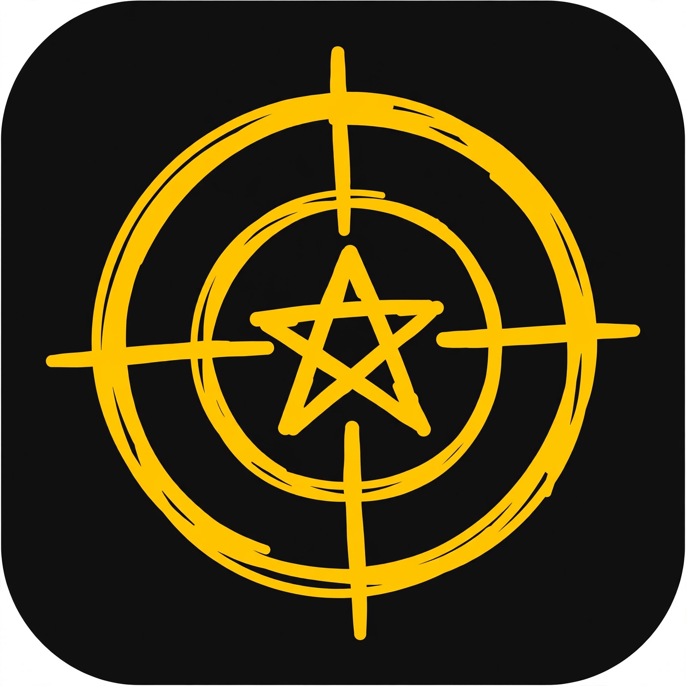
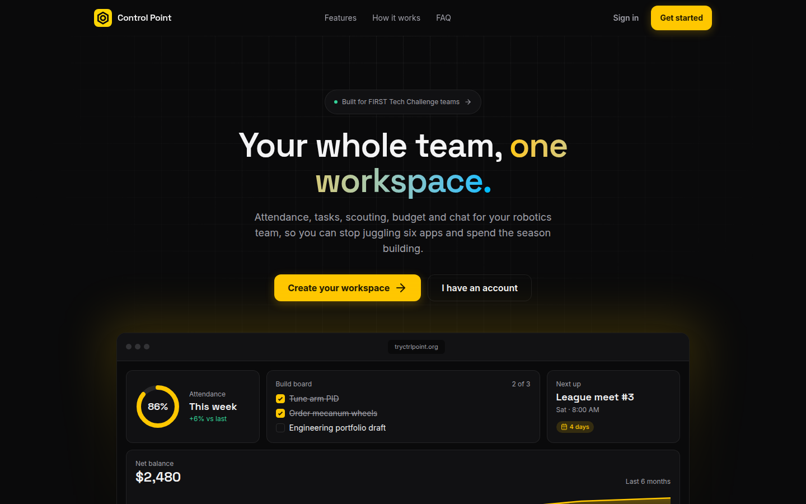
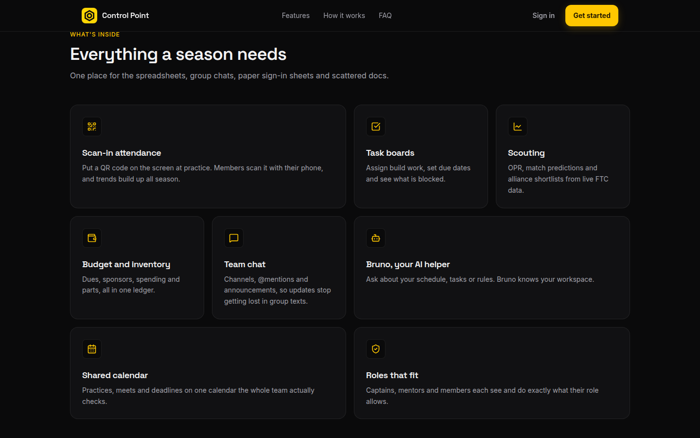

<p align="center">
  
</p>

<h1 align="center">Control Point</h1>

<p align="center"><b>The all-in-one HQ for FTC robotics teams.</b></p>

<p align="center">
  Tasks, scouting, build tracking, CAD, and an AI coach — in one place.
</p>

<p align="center">
  <a href="https://tryctrlpoint.org"><b>🚀 Live Demo</b></a>
</p>

<p align="center">
  
  
  
  
  
  
  
</p>

---

## Screenshots

| Landing | Features |
|---|---|
|  |  |

---

## Features

**Run the season**
- **Dashboard** — team health at a glance: attendance, tasks, budget, upcoming events, and Bruno's briefing on what matters today
- **Tasks** — Kanban board with assignments, due dates, and priorities
- **Calendar** — shared team calendar: meetings, competitions, deadlines
- **Attendance** — session tracking with QR check-in
- **Communication** — a real log with email-style reply threads, inbound/outbound tracking, and Bruno-assisted email import
- **Messaging** — team channels with mentions and threads
- **Members & Roles** — roster with granular role-based permissions

**Build the robot**
- **CAD & Code** — model viewer and robot code management tied to the team
- **Inventory** — parts tracking with low-stock alerts
- **Budget** — income/expense tracking with a running balance

**Compete**
- **Team Stats** — scouting that works: live event data, OPR breakdowns (auto / teleop / endgame), and alliance scenario planning
- **Predict (beta)** — advancement forecasting, not guessing: EPA-style ratings carried across events with time decay, head-to-head win probabilities and expected scores, Monte Carlo event simulation (quals, alliance selection, playoffs), calibration-tuned on 2024–25 and tested on 2025–26 with strict temporal splits, plus team-specific award priors. See [docs/predict/](docs/predict/) for the full methodology and back-test reports

**Ask Bruno**
- **Bruno — your FTC coach.** An AI assistant that lives in the app, not in a separate tab. Ask it build questions, have it write Java for your OpModes, or let it take action directly: log emails, create tasks, schedule events. It knows what page you're on and suggests what it can do there
- **Voice channels** — open team voice rooms anyone can join
- **Outreach** — log service hours and events
- **Owner portal** — usage, AI controls, and feature flags

---

## Quick start

```bash
npm install
npm run dev
```

Open `http://localhost:3000`. Create the admin account on the login screen — you're up and running with a local SQLite database.

## Configuration

Copy the essentials into a `.env` file:

```bash
# Database — embedded SQLite file by default. Production uses Turso:
# DATABASE_URL="libsql://your-db.turso.io"
# DATABASE_AUTH_TOKEN="your-turso-auth-token"

# Public URL (used for OAuth callbacks)
# APP_URL="https://tryctrlpoint.org"

# Google OAuth (optional)
# GOOGLE_CLIENT_ID=""
# GOOGLE_CLIENT_SECRET=""

# Discord OAuth (optional)
# DISCORD_CLIENT_ID=""
# DISCORD_CLIENT_SECRET=""

# AI (Bruno) — Gemini for chat, grounded research, and vision; Anthropic as fallback
# GEMINI_API_KEY=""
# ANTHROPIC_API_KEY=""
# ANTHROPIC_MODEL="claude-sonnet-5-5"   # optional; this is the default
# ANTHROPIC_EFFORT="low"                # optional: low | medium | high | xhigh | max
# GEMINI_THINKING_LEVEL="low"           # optional: minimal | low | medium | high (unset: the model's default)
# Bruno web checks (prices, stock, fact-checks) use Gemini google_search grounding, or
# Claude's web_search / web_fetch tools when Claude answers. Turn web search on for the
# organization in the Claude Console; if it is off, Claude answers without it.
```

Google sign-in only works for emails already on the team roster — an admin adds members first, then they link their Google account.

## Deploy

Production runs on an Oracle Cloud Always Free VM: nginx → the app on `:3000` via systemd, with Turso as the hosted database. Push to `main`, deploy, restart the service.

## Tech

- **Frontend:** React 19 + TypeScript + Tailwind CSS 4 (Vite), shadcn/ui on Radix primitives
- **Backend:** Express + WebSocket
- **Database:** SQLite via `@libsql/client` — embedded file locally, Turso hosted in production
- **AI:** Gemini (chat, grounded research, vision) with Anthropic fallback, per-user controls and usage tracking

## Contributing

Every change goes through a pull request and gets reviewed to a 5/5 confidence score before merging. Keep commits small, meaningful, and buildable.

## License

GPL v3 — see [LICENSE](LICENSE).
